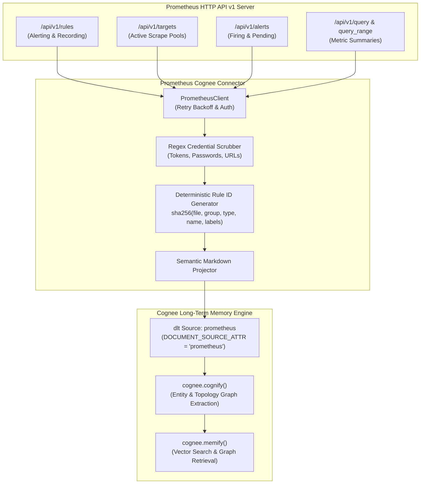

# Prometheus Connector for Cognee

An open-source data-source connector that ingests Prometheus alerting rules, recording rules, active scrape targets, and PromQL metric summaries into Cognee cognitive memory graphs.

---

## Architecture Overview



---

## Features

- **Rule Ingestion**: Ingests both alerting and recording rules, including duration, health status, PromQL query expressions, labels, and annotations.
- **Scrape Pool Topology**: Maps out active scrape targets, endpoints, health statuses, and instance labels into structured Markdown tables.
- **Metric Summaries**: Executes allowlisted PromQL queries and produces top-series evaluation tables for AI agents.
- **Forget-on-Delete Reconciliation**: Employs `write_disposition="replace"` so decommissioned rules or deleted targets are automatically pruned via `orphan_cleanup`.
- **Credential Protection**: Redacts sensitive tokens, HTTP Basic passwords, and credential parameters from labels and annotations before memory ingestion.
- **Production Hardened**: Exponential retry backoff on HTTP 429/5xx status codes and 100% offline mock test suite.

---

## Quickstart

```python
import asyncio
import os
import cognee
from cognee_community_connector_prometheus import PrometheusConfig, prometheus_source

async def main():
    config = PrometheusConfig(
        base_url="http://localhost:9090",
        bearer_token=os.environ.get("PROMETHEUS_BEARER_TOKEN"),
        include_targets=True,
        promql_queries=["up", "rate(http_requests_total[5m])"],
        write_disposition="replace",
    )

    source = prometheus_source(config=config)
    await cognee.remember(source, dataset_name="prometheus_memory")

    results = await cognee.search(
        query_text="Which alerting rules fire when HTTP error rate exceeds 5%?",
        query_type=cognee.SearchType.GRAPH_COMPLETION,
        datasets=["prometheus_memory"],
    )
    print(results)

if __name__ == "__main__":
    asyncio.run(main())
```

---

## Testing

Run the offline pytest suite:

```bash
pytest packages/connector/prometheus/tests -v
```
