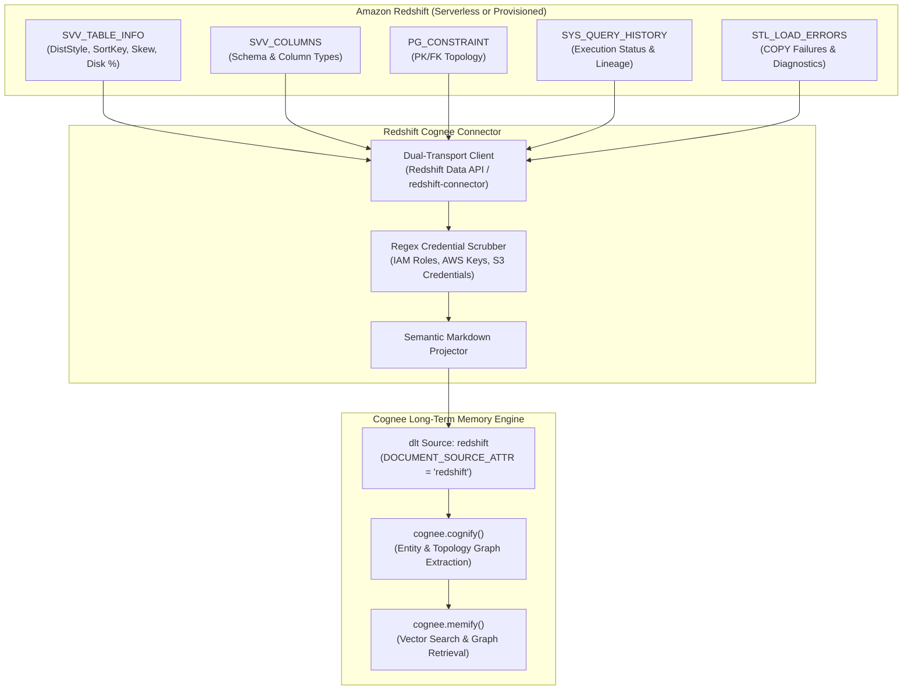

# Amazon Redshift Connector for Cognee

An open-source data-source connector that ingests Amazon Redshift table physical layouts (distribution style, sort keys, row skew), column schemas, PK/FK constraints, and operational query lineage into Cognee cognitive memory graphs.

---

## Architecture Overview



---

## Features

- **Dual Transport Support**:
  - AWS Redshift Data API via `boto3` (`redshift-data`) for zero-tunneling async execution against Serverless workgroups or Provisioned clusters.
  - Direct DB-API connection via `redshift-connector` for dedicated VPC/bastion connectivity.
- **Physical Layout & Performance**: Ingests distribution styles, primary sort keys, row skew factors, and disk usage percentages so AI agents can optimize SQL queries.
- **Operational Query Lineage**: Captures recent query executions and execution durations from `SYS_QUERY_HISTORY`.
- **COPY Error Diagnostics**: Ingests raw line errors and failure reasons from `STL_LOAD_ERRORS` to accelerate data pipeline troubleshooting.
- **Forget-on-Delete**: Employs `write_disposition="replace"` so dropped tables or altered schemas are cleanly pruned via `orphan_cleanup`.
- **Zero Credential Leakage**: Automatically scrubs IAM role ARNs, AWS access keys, and inline S3 credentials from query strings.

---

## Quickstart

```python
import asyncio
import os
import cognee
from cognee_community_connector_redshift import RedshiftConfig, redshift_source

async def main():
    config = RedshiftConfig(
        transport="data_api",
        workgroup_name=os.environ.get("REDSHIFT_WORKGROUP_NAME"),
        database="analytics",
        schemas=["public", "analytics"],
        include_query_history=True,
        include_load_errors=True,
    )

    source = redshift_source(config=config)
    await cognee.remember(source, dataset_name="redshift_memory")

    results = await cognee.search(
        query_text="Which tables have high row skew or sort key misconfigurations in the analytics schema?",
        query_type=cognee.SearchType.GRAPH_COMPLETION,
        datasets=["redshift_memory"],
    )
    print(results)

if __name__ == "__main__":
    asyncio.run(main())
```

---

## Testing

Run the offline pytest suite:

```bash
pytest packages/connector/redshift/tests -v
```
